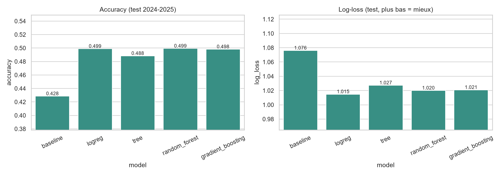
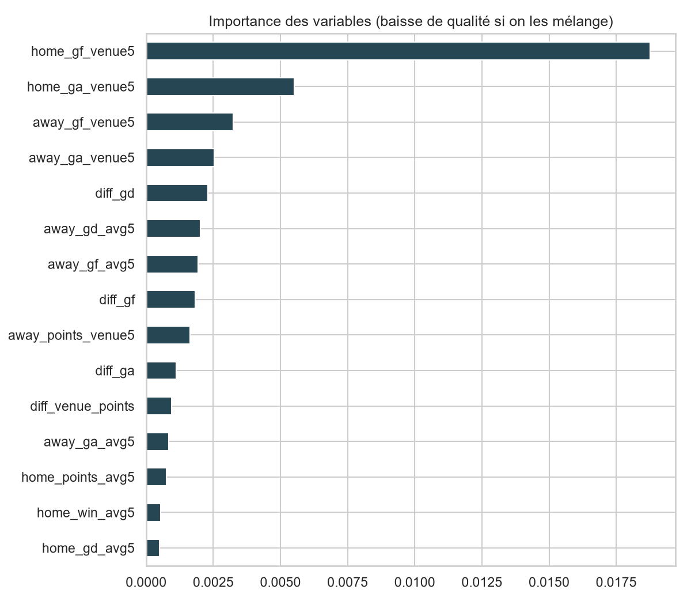
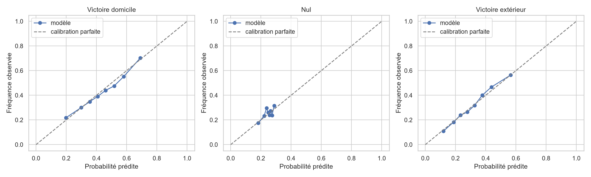

# Football Match Prediction

Un projet de Data Science où j'essaie de prédire l'issue de matchs de football (victoire à domicile, nul, victoire à l'extérieur) à partir des résultats passés de huit championnats européens.

Je ne cherche pas à "battre les bookmakers" : l'objectif est de construire une démarche propre, sans triche statistique, et de voir honnêtement ce qu'on peut tirer de ces données.

## La question

Dans quelle mesure les résultats passés permettent-ils de prédire un match, et quels modèles tiennent le mieux sur des matchs **postérieurs** à ceux utilisés pour les entraîner ?

## Les données

- Source : [Football-Data.co.uk](https://www.football-data.co.uk/) (un fichier CSV par ligue et par saison).
- 8 championnats : Premier League, La Liga, Bundesliga, Serie A, Ligue 1, Eredivisie, Primeira Liga, Pro League.
- Saisons 2015-2016 à 2024-2025, soit **26 791 matchs** après nettoyage.
- Les fichiers bruts ne sont pas dans le dépôt (ils sont retéléchargeables) : c'est `src/download_data.py` qui s'en charge.

## Organisation du dépôt

```text
football-match-prediction/
├── data/
│   ├── raw/            # CSV téléchargés (non versionnés)
│   └── processed/      # données nettoyées + variables
├── notebooks/
│   ├── 01_data_exploration.ipynb     # analyse exploratoire
│   ├── 02_feature_engineering.ipynb  # variables + test anti-fuite
│   └── 03_results.ipynb              # résultats et interprétation
├── src/
│   ├── config.py            # chemins, ligues, saisons
│   ├── download_data.py     # collecte
│   ├── preprocess_data.py   # nettoyage
│   ├── build_features.py    # création des variables
│   ├── train_model.py       # entraînement et comparaison
│   └── evaluate_model.py    # métriques et matrices de confusion
├── models/             # modèle sauvegardé (non versionné)
├── reports/            # résultats chiffrés et figures
├── requirements.txt
└── README.md
```

## Installation

```bash
git clone https://github.com/Hojine-06/football-match-prediction.git
cd football-match-prediction
python -m venv .venv
.venv\Scripts\activate        # sous Linux/Mac : source .venv/bin/activate
pip install -r requirements.txt
```

J'ai développé le projet avec Python 3.15 sous Windows. Je ne l'ai pas testé ailleurs.

## Lancer le projet

Les scripts s'enchaînent dans cet ordre :

```bash
python src/download_data.py     # 1. télécharge les CSV
python src/preprocess_data.py   # 2. nettoie et fusionne
python src/build_features.py    # 3. construit les variables
python src/train_model.py       # 4. entraîne et évalue les modèles
```

Les notebooks servent à regarder les données et les résultats, pas à produire le pipeline.

## Ma démarche

**Nettoyage.** Je convertis les dates (les formats changent selon les saisons), je supprime les doublons et je vérifie que le résultat (H/D/A) correspond bien au score. Les colonnes de tirs, corners et fautes sont absentes ou incomplètes sur plusieurs saisons : je ne les utilise donc pas.

**Variables (26 au total).** Pour chaque équipe, je calcule des moyennes sur ses 5 matchs précédents : buts marqués et encaissés, points, victoires, nuls, différence de buts, forme à domicile ou à l'extérieur, jours de repos. J'ajoute aussi la différence entre les deux équipes.

**Éviter la fuite d'information.** C'est le piège classique de ce genre de projet : si une variable contient une info du match à prédire, le modèle paraît excellent mais ne vaut rien. Mes moyennes utilisent `shift(1)`, donc le match courant est toujours exclu. Je l'ai aussi vérifié à la main : j'ai recalculé les variables de 300 matchs tirés au hasard, sans aucun écart avec le fichier.

**Séparation dans le temps.** Pas de découpage aléatoire (il mélangerait passé et futur) :

| Ensemble | Saisons |
|---|---|
| Entraînement | 2015-2016 à 2021-2022 |
| Validation | 2022-2023 et 2023-2024 |
| Test | 2024-2025 (2640 matchs) |

Je choisis le modèle sur la validation (critère : la log-loss), puis je le ré-entraîne sur entraînement + validation et je le teste **une seule fois** sur 2024-2025.

**Modèles.** Une référence très simple (toujours prédire la classe la plus fréquente), puis régression logistique, arbre de décision, Random Forest et Gradient Boosting.

## Résultats (test, saison 2024-2025)

| Modèle | Accuracy | Log-loss | F1 macro | F1 des nuls |
|---|---|---|---|---|
| Référence (classe majoritaire) | 42.8% | 1.076 | 0.20 | 0.00 |
| **Régression logistique** (retenu) | 49.9% | 1.015 | 0.37 | 0.00 |
| Arbre de décision | 48.8% | 1.027 | 0.37 | 0.01 |
| Random Forest | 49.9% | 1.020 | 0.37 | 0.00 |
| Gradient Boosting | 49.8% | 1.021 | 0.37 | 0.01 |

Le modèle retenu fait un peu mieux que la référence : +7.0 point(s) d'accuracy et une log-loss plus basse (+0.061). C'est un gain modeste, mais c'est ce qu'on peut attendre d'un problème où le hasard pèse autant.

Les matchs nuls sont le vrai point faible : le modèle n'en repère que **0.0 %**. C'est attendu, un nul n'a pas de "profil" clair dans les statistiques passées.





## Limites

- Les variables viennent uniquement des buts et résultats passés : pas de blessures, de compositions, de calendrier de coupe ni de budget des clubs.
- Les équipes tout juste promues ont peu d'historique.
- Une seule saison de test : les chiffres peuvent changer d'une saison à l'autre.
- Le football garde une grande part de hasard, donc ces résultats ne sont pas une promesse de prédiction.

## Pistes pour la suite

Prédire le nombre de buts, ajouter d'autres sources de statistiques, comparer les modèles ligue par ligue, faire une petite interface de démonstration.

## Auteur

Hojine Anagonou, étudiant en Analyse Informatique et Programmation (ENEAM, Université d'Abomey-Calavi).
Contact : anagonouhojine@gmail.com
